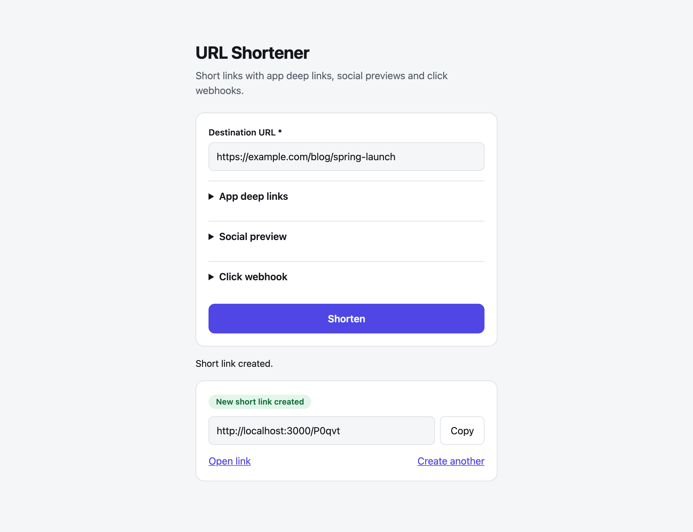
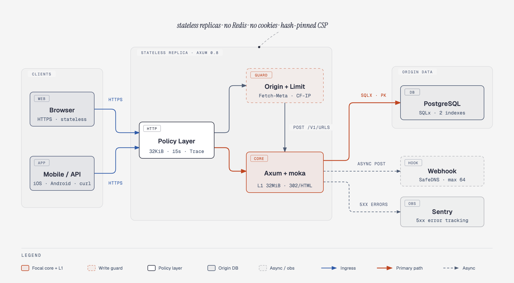
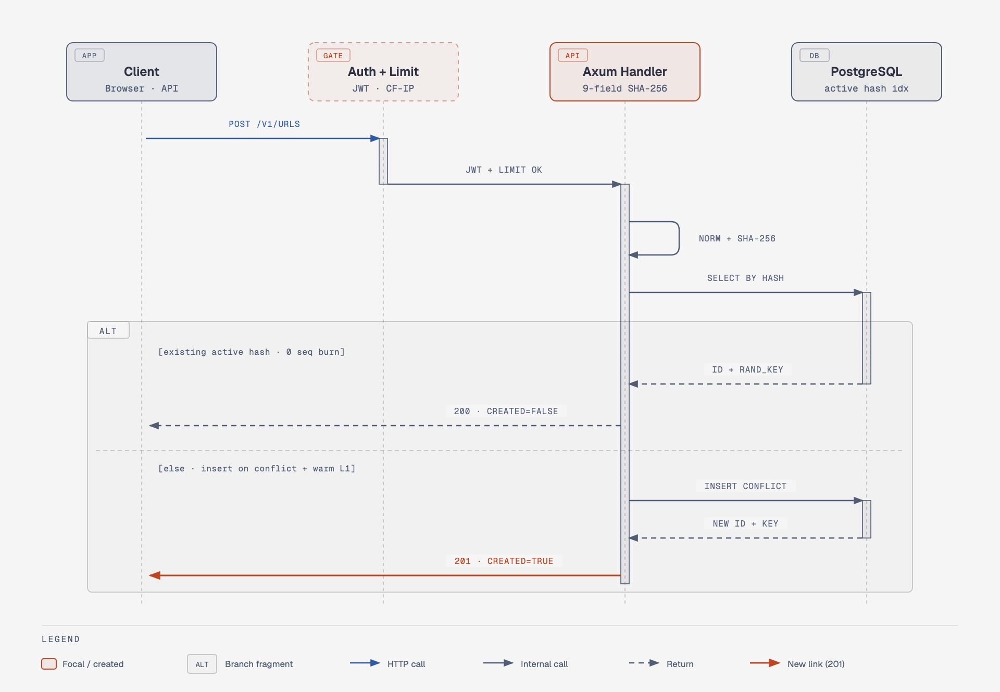
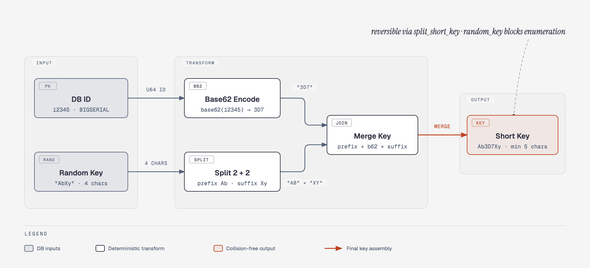
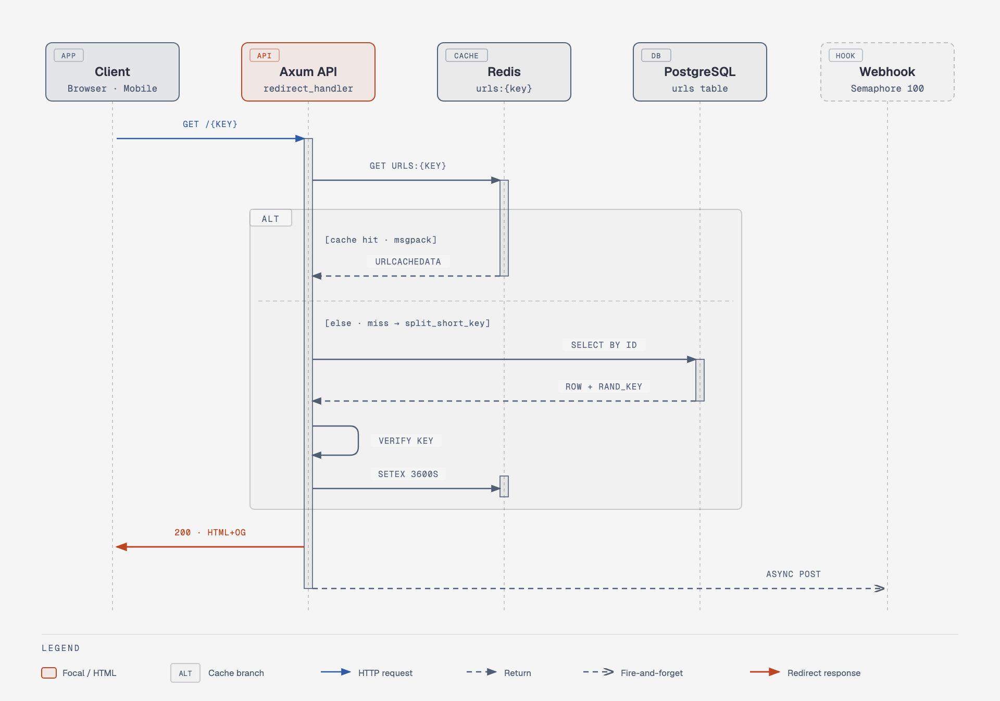
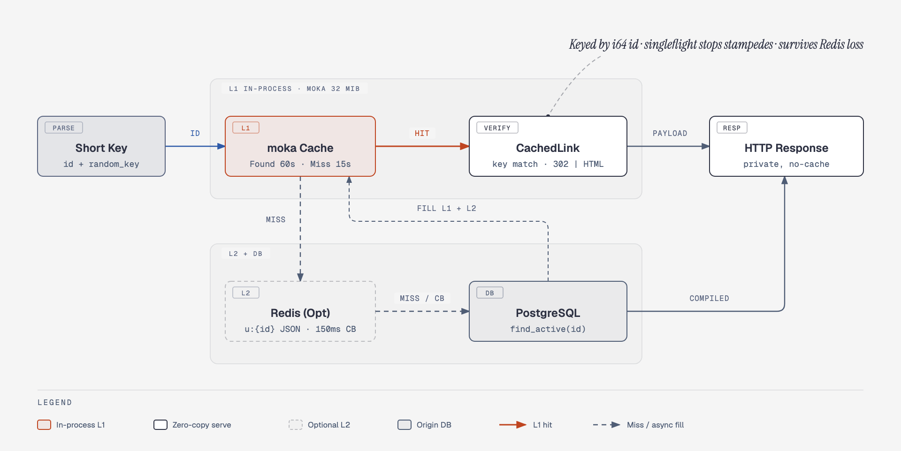

# URL Shortener Service

[한국어](README.md) | [English](README.en.md)

🚀 **Demo:** [https://u.lou2.kr](https://u.lou2.kr)



A high-performance URL shortening service built with Rust. Supports deep link handling, platform-specific redirects, Open Graph metadata, JWT authentication, Redis MessagePack caching, and semaphore-bounded webhook notifications.

## Architecture

<picture>
  <source media="(prefers-color-scheme: dark)" srcset="docs/diagrams/architecture-dark.png">
  
</picture>

## Core Technologies

| Area | Technology | Description |
|------|------------|-------------|
| Web Framework | **Axum 0.8 + Tower** | Async HTTP server, SmartIP rate limiting, gzip/br/zstd compression |
| Database | **PostgreSQL + SQLx** | Type-safe queries and automatic migrations |
| Cache | **Redis + MessagePack** | High-speed `rmp-serde` binary caching (`urls:{short_key}`) |
| Auth | **JWT** | `Authorization: Bearer` header and `token` cookie authentication |
| Hashing | **xxHash (`xxh3_128`)** | Fast duplicate URL detection with race-safe `ON CONFLICT` |
| Templates | **Askama** | Compile-time checked HTML rendering (OG tags + deep link script) |
| Memory | **mimalloc** | High-performance global allocator |
| Observability | **Sentry + tracing** | Structured logging and automatic 5xx error reporting |

## URL Creation Flow

<picture>
  <source media="(prefers-color-scheme: dark)" srcset="docs/diagrams/url-creation-flow-dark.png">
  
</picture>

### Short Key Generation

<picture>
  <source media="(prefers-color-scheme: dark)" srcset="docs/diagrams/short-key-encoding-dark.png">
  
</picture>

**Features:**
- Collision-free generation backed by PostgreSQL `BIGSERIAL` IDs
- 4-character random key split into 2-char prefix + 2-char suffix to prevent sequential enumeration
- Reversible via `split_short_key` and verified against stored `random_key` on cache miss
- Constant-time key generation independent of table size

## URL Redirect Flow

<picture>
  <source media="(prefers-color-scheme: dark)" srcset="docs/diagrams/url-redirect-flow-dark.png">
  
</picture>

### Platform-Specific Redirect

<picture>
  <source media="(prefers-color-scheme: dark)" srcset="docs/diagrams/platform-redirect-dark.png">
  
</picture>

- Open Graph, Twitter Card, and Schema.org tags are rendered server-side in HTML so social crawlers read link previews before client JS runs.
- On iOS/Android, configured deep links are launched first with a `2000ms` fallback timer to the platform fallback URL (or `default_fallback_url` when unset).

## Caching Strategy

<picture>
  <source media="(prefers-color-scheme: dark)" srcset="docs/diagrams/caching-strategy-dark.png">
  
</picture>

**Why MessagePack:**
- 30–50% smaller than JSON (`UrlCacheData` omits timestamp columns)
- Fast binary serialization/deserialization (`rmp-serde`)
- Graceful fallback: cache write failures are logged without blocking redirect responses

## Getting Started

### Prerequisites

- Rust (stable, pinned via `rust-toolchain.toml`)
- PostgreSQL
- Redis

### Run

```bash
# Clone repository
git clone https://github.com/lee-lou2/url-shortener.git
cd url-shortener

# Configure environment
cp .env.example .env

# Run
cargo run --release
```

### Docker

```bash
docker build -t url-shortener .
docker run -p 3000:3000 --env-file .env url-shortener
```

### Key Environment Variables

| Variable | Default | Description |
|----------|---------|-------------|
| `SERVER_PORT` | `3000` | HTTP server port |
| `RUST_ENV` | `development` | Runtime mode (`production` enforces `JWT_SECRET` & Secure cookies) |
| `DB_HOST` | `localhost` | PostgreSQL host |
| `REDIS_HOST` | `localhost` | Redis host |
| `REDIS_MAX_CONNECTIONS` | `20` | Max Redis pool connections |
| `JWT_SECRET` | - | JWT secret (required in production, min 32 chars) |
| `CACHE_TTL_SECS` | `3600` | Redis cache TTL (seconds) |
| `RATE_LIMIT_PER_SECOND` | `10` | Requests per second limit |
| `RATE_LIMIT_BURST_SIZE` | `50` | Rate limiter burst size |
| `WEBHOOK_TIMEOUT_SECS` | `10` | Webhook HTTP request timeout (seconds) |
| `WEBHOOK_MAX_CONCURRENT` | `100` | Max concurrent webhook tasks (semaphore) |
| `RUN_MIGRATIONS` | `true` | Auto-run SQLx migrations on startup |

## API

| Method | Path | Auth | Description |
|--------|------|:----:|-------------|
| `GET` | `/` | - | Renders main page and issues guest JWT cookie (`token`) |
| `POST` | `/v1/urls` | JWT | Creates a short URL (returns existing `short_key` on duplicate) |
| `GET` | `/{short_key}` | - | Returns OG-enabled HTML page for platform-aware redirect |
| `GET` | `/health` | - | Liveness probe (`{ status, version }`) |
| `GET` | `/ready` | - | Readiness probe (verifies PostgreSQL and Redis connectivity) |

### `POST /v1/urls` - Create URL

Requires `Authorization: Bearer <token>` header or `token` cookie.

**Request:**
```json
{
  "defaultFallbackUrl": "https://example.com",
  "iosDeepLink": "myapp://path",
  "iosFallbackUrl": "https://apps.apple.com/app/myapp",
  "androidDeepLink": "myapp://path",
  "androidFallbackUrl": "https://play.google.com/store/apps/details?id=com.myapp",
  "webhookUrl": "https://webhook.example.com",
  "ogTitle": "Title",
  "ogDescription": "Description",
  "ogImageUrl": "https://example.com/image.jpg"
}
```

**Response:**
```json
{
  "message": "URL created successfully",
  "short_key": "Ab3D7Xy"
}
```

### `GET /{short_key}` - Redirect

Returns the Askama-rendered HTML redirect page and, if `webhookUrl` is configured, fires an async `POST` webhook with `{ short_key, user_agent }`.

## Project Structure

```
├── src/
│   ├── main.rs           # Entry point, middleware stack, graceful shutdown
│   ├── lib.rs            # Library crate exports
│   ├── error.rs          # Centralized error handling (AppError, AppResult)
│   ├── api/              # HTTP handlers, routes, schemas, JWT middleware
│   ├── config/           # Environment config, PostgreSQL/Redis pool setup
│   ├── models/           # Url, UrlCacheData, UrlRepository, async webhooks
│   └── utils/            # JWT, Base62 short keys, random strings
├── migrations/           # SQLx migration files
├── views/                # Askama HTML templates (index.html, redirect.html)
├── tests/                # Integration tests (runnable without DB)
└── docs/
    ├── screenshot.png    # Demo screenshot
    └── diagrams/         # Editorial architecture & flow diagrams (PNG + HTML/SVG sources)
```

See [docs/diagrams/README.md](docs/diagrams/README.md) for the full diagram catalog and editable HTML/SVG sources.

## License

MIT License
