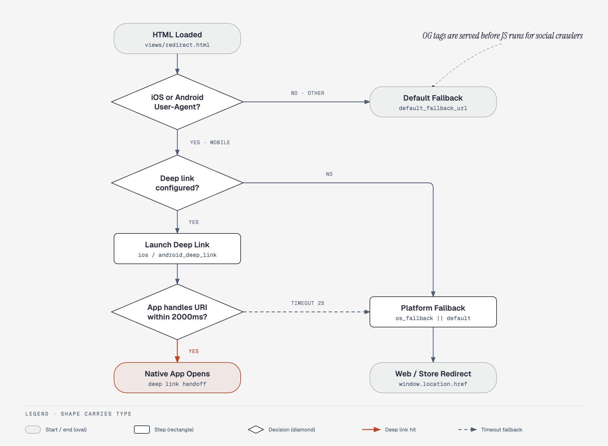

# URL Shortener

[한국어](README.md) | [English](README.en.md)

🚀 **Demo:** [https://u.lou2.kr](https://u.lou2.kr)


A fast URL shortener written in Rust (Axum + PostgreSQL). It creates short links with app deep links, platform fallbacks,
Open Graph previews and click webhooks. Plain links are redirected with a single `302`.

## Features

- **Collision-free short keys** derived from the database id (`prefix(2) + base62(id) + suffix(2)`); the same payload returns the existing link
- **Deep links** for iOS / iPadOS / Android with store fallbacks; once the app opens, the fallback timer is cancelled
- **Social previews**: Open Graph / Twitter Card tags for link-preview crawlers, with a live preview in the creation form
- **Click webhooks**: async `POST` per visit, SSRF-protected, bounded concurrency, drained on shutdown
- **Layered cache**: in-process `moka` L1, optional Redis L2 (JSON), PostgreSQL as the source of truth
- **Secure by default**: `http(s)` allow-list, hash-pinned CSP, per-IP rate limits, generic 5xx errors, fail-fast configuration

## Architecture

<picture>
  <source media="(prefers-color-scheme: dark)" srcset="docs/diagrams/architecture-dark.png">
  
</picture>

| Area | Technology |
|------|------------|
| Web | Axum 0.8, Tower, Tokio |
| Data | PostgreSQL + SQLx (migrations embedded, run on boot) |
| Cache | `moka` (L1) + optional Redis `ConnectionManager` (L2, `u:{id}` JSON) |
| Pages | Plain HTML/CSS/JS in `views/` (no build step, no CDN); Askama renders the redirect page |
| Auth | Guest JWT (`token` cookie or `Authorization: Bearer`) |
| Ops | Sentry, `tracing`, mimalloc (Linux/macOS), graceful shutdown |

### Redirect: `GET /{short_key}`

<picture>
  <source media="(prefers-color-scheme: dark)" srcset="docs/diagrams/url-redirect-flow-dark.png">
  
</picture>

| The link has | Response |
|--------------|----------|
| only a destination URL (a webhook does not matter) | `302 Found` + `Location`, empty body |
| deep links, platform fallbacks or Open Graph fields | `200 OK` HTML: OG tags + a platform-aware redirect script |
| invalid, unknown or deleted key | `404` `{"error":"URL not found"}` |

Every redirect response carries `Cache-Control: private, no-cache`, so each click reaches the origin (webhooks fire, takedowns apply quickly).

<picture>
  <source media="(prefers-color-scheme: dark)" srcset="docs/diagrams/platform-redirect-dark.png">
  
</picture>

The HTML page works like this: desktop browsers go straight to the destination. On iOS, iPadOS (detected as `MacIntel` + touch) and Android it tries the
deep link and, if the page is still visible after 1.5 s, replaces itself with the platform fallback (or the destination). If the page is hidden or loses focus
(the app opened), the timer is cancelled. Navigation uses `location.replace`, so Back never loops. A visible **Continue** link is always present,
and without JavaScript an instant `<meta refresh>` (inside `<noscript>`) leads to the destination.

### Short keys

<picture>
  <source media="(prefers-color-scheme: dark)" srcset="docs/diagrams/short-key-encoding-dark.png">
  
</picture>

- Format `[2 random][base62(id)][2 random]`, alphabet `0-9A-Za-z`, length `5..=15`; the id part never starts with `0`
- The key is parsed before any cache or database access; anything malformed is a `404`
- The random part is verified against the stored `random_key`, which makes enumerating ids by guessing impractical

### Creation: `POST /v1/urls`

<picture>
  <source media="(prefers-color-scheme: dark)" srcset="docs/diagrams/url-creation-flow-dark.png">
  
</picture>

Fields are trimmed (empty ⇒ absent) and validated once, then a SHA-256 over all 9 normalized fields identifies the link:
`SELECT` → `INSERT … ON CONFLICT DO NOTHING` → `SELECT` again only on a concurrent race. Duplicates burn no sequence value, and a new link warms the L1 cache.

### Caching

<picture>
  <source media="(prefers-color-scheme: dark)" srcset="docs/diagrams/caching-strategy-dark.png">
  
</picture>

L1 is keyed by the decoded id (found entries live 60 s, missing entries 15 s, byte-capped, concurrent loads of one key are coalesced). L2 Redis is optional:
when `REDIS_HOST` is unset or Redis is down, the service keeps serving from L1 + PostgreSQL.

## Quickstart

Requires Rust (1.88+, see `rust-version` in `Cargo.toml`) and Docker.

```bash
git clone https://github.com/lee-lou2/url-shortener.git && cd url-shortener
docker compose up -d      # PostgreSQL 15 + Redis 7 for development
cp .env.example .env
cargo run                 # applies migrations, then http://localhost:3000
```

Checks: `cargo fmt --check && cargo clippy --all-targets -- -D warnings && cargo test` (tests use the compose services).
Production runs as a single container behind a Cloudflare Tunnel (see `Dockerfile`, `deploy.sh`) with `RUST_ENV=production`.

## Configuration

Authoritative, commented list: [`.env.example`](.env.example).

<!-- keep in sync with src/config.rs and .env.example -->

| Variable | Default | Description |
|----------|---------|-------------|
| `SERVER_PORT` | `3000` | HTTP port |
| `RUST_ENV` | `development` | `production`/`prod` requires `JWT_SECRET` (≥ 32 bytes) and adds `Secure` to the cookie (`development`/`dev`/`test` allowed, case-insensitive) |
| `RUST_LOG` | `info` | `tracing_subscriber` log filter |
| `JWT_SECRET` | — | Guest-token signing secret |
| `JWT_EXPIRATION_HOURS` | `24` | `1..=8760`; also the cookie `Max-Age` |
| `DB_HOST`, `DB_PORT`, `DB_USER`, `DB_PASSWORD`, `DB_NAME` | see `.env.example` | PostgreSQL connection parts (passwords with special characters are safe) |
| `DB_MAX_CONNECTIONS` | `10` | Pool size |
| `RUN_MIGRATIONS` | `true` | Apply `migrations/` on boot (`true`/`1`/`yes`, `false`/`0`/`no`) |
| `REDIS_HOST` | — | Unset or empty ⇒ L1-only mode (`cache: "disabled"` in `/ready`) |
| `REDIS_PORT`, `REDIS_USER`, `REDIS_PASSWORD`, `REDIS_DB` | see `.env.example` | Redis connection parts (L2 TTL matches L1: ≤ 60 s) |
| `CACHE_MAX_CAPACITY_BYTES` | `33554432` | L1 byte cap (32 MiB) |
| `RATE_LIMIT_PER_SECOND` | `10` | Per-IP rate for `POST /v1/urls` and `GET /` |
| `RATE_LIMIT_BURST_SIZE` | `20` | Per-IP burst for the same routes |
| `CORS_ORIGINS` | — | Comma-separated origins; empty disables CORS (`*` is dev-only and ignored with a warning in production) |
| `SENTRY_DSN`, `SENTRY_TRACES_SAMPLE_RATE` | — / `0.1` | Optional; 5xx error reporting and traces sample rate (`0.0..=1.0`) |

Removed legacy environment variables (such as `CACHE_TTL_SECS` or `WEBHOOK_*`) are safely ignored, and empty values (`KEY=`) fall back to defaults.

## API

| Method | Path | Auth | Description |
|--------|------|:----:|-------------|
| `GET` | `/` | – | Web UI; sets the guest cookie `token` (`HttpOnly; SameSite=Lax; Path=/; Max-Age=…`, `Secure` in production) |
| `POST` | `/v1/urls` | token | Create or reuse a short link |
| `GET` | `/{short_key}` | – | `302` or HTML redirect (see above) |
| `GET` | `/health` | – | `{"status":"ok","version":"…"}` |
| `GET` | `/ready` | – | PostgreSQL `SELECT 1` and Redis `PING`: `200 ok`, `200 degraded` (Redis down, still serving), `503 error` (database down) |

### `POST /v1/urls`

Send the `token` cookie or `Authorization: Bearer <token>` (scheme is case-insensitive). The token is a guest token, not an identity:

```bash
# 1) obtain the guest cookie
curl -s -c jar.txt https://u.lou2.kr/ -o /dev/null
# 2) create a link
curl -s -b jar.txt https://u.lou2.kr/v1/urls \
  -H 'Content-Type: application/json' \
  -d '{"defaultFallbackUrl":"https://example.com","iosDeepLink":"myapp://home","iosFallbackUrl":"https://apps.apple.com/app/myapp"}'
# => {"message":"URL shortened successfully","short_key":"Ab3D7Xy","created":true}
```

| Field | Required | Rules |
|-------|:--------:|-------|
| `defaultFallbackUrl` | ✓ | `http`/`https` URL, ≤ 2048 bytes |
| `iosFallbackUrl`, `androidFallbackUrl`, `ogImageUrl` | | `http`/`https` URL |
| `iosDeepLink`, `androidDeepLink` | | Any scheme except `javascript`, `data`, `vbscript`, `file`, `blob`, `about` |
| `ogTitle` / `ogDescription` | | ≤ 200 / ≤ 500 characters |
| `webhookUrl` | | `http`/`https` URL on a public host; receives `POST {"short_key","user_agent"}` per visit |

Empty strings count as absent. Success: `201` `{"message":"URL shortened successfully","short_key":"…","created":true}`, or `200`
`{"message":"URL already exists","short_key":"…","created":false}`. Every error is `{"error":"…"}`: `400`/`422` validation, `401` missing or invalid token,
`408` timeout (15 s), `413` body > 32 KiB, `429` rate limited (with `Retry-After`), `500` generic.

## Security model

- **XSS:** URLs are allow-listed (`http`/`https`; deep links exclude executable schemes) and re-validated when a cached entry is compiled, so legacy rows cannot smuggle `javascript:`.
  Both pages carry exactly one inline script pinned by `script-src 'sha256-…'` (`default-src 'none'`), take dynamic data only from escaped `data-*` attributes, and send `X-Content-Type-Options: nosniff`.
- **SSRF:** webhooks use one shared client with a DNS resolver that rejects non-global addresses (loopback, RFC 1918, link-local/metadata, CGNAT, ULA, mapped IPv4),
  literal-IP hosts are checked at create and dispatch time, redirects are disabled, requests time out after 5 s, concurrency is bounded, in-flight calls drain on shutdown.
- **Abuse limits:** per-IP rate limits on `POST /v1/urls` and `GET /`. Behind Cloudflare the client IP comes from `CF-Connecting-IP`, trusted only when the TCP peer is loopback/private. Redirects and health checks are not throttled.
- **Auth:** the guest JWT is a speed bump (anyone loading `/` gets one), not user identity. Production refuses to start without a ≥ 32-byte `JWT_SECRET`.
- **Hygiene:** JSON errors with generic 5xx messages, 32 KiB body limit, 15 s request timeout, no credentials interpolated into connection URLs.
- **Takedown:** `UPDATE urls SET deleted_at = now() WHERE id = …` (L1 entries expire within 60 s; also `DEL u:{id}` when Redis L2 is enabled).

## Performance

Measured on a single worker thread (`TOKIO_WORKER_THREADS=1`) on local macOS (Apple Silicon) against PostgreSQL 15.19 (**1,000,000 rows**, ~85% plain + ~15% OG/deep-link) and Redis 8.10 using the same compiled Rust HTTP/1.1 keep-alive harness before and after the v2 redesign (absolute throughput on a 1 CPU / 512 MB Linux container will differ).

| Experiment | Before (`main`) | After (v2) | Improvement |
|------------|----------------:|-----------:|-------------|
| PostgreSQL indexes (1M rows) | 5 indexes (**129.8 MB**) | 2 indexes (**78.0 MB**) | **-39.9%** (3 redundant dropped) |
| 10k bulk `INSERT` / WAL | 63.5k rows/s · 4.10 MB | **119.8k rows/s · 1.76 MB** | **1.89× throughput · -57.1% WAL** |
| Hot Zipfian redirects (c=32, `br,gzip`) | 20,643 RPS (p99 2.27 ms) | **120,303 RPS** (p99 **0.37 ms**) | **5.83× RPS · 6.1× lower p99** |
| Hot Zipfian redirects (c=64, `br,gzip`) | 21,252 RPS (p99 3.69 ms) | **139,324 RPS** (p99 **0.64 ms**) | **6.56× RPS · 5.8× lower p99** |
| Hot / Cold 1M (L1-only, `REDIS_HOST=""`) | — | **147,417 / 35,475 RPS** (p99 0.31 / 1.32 ms) | +22–25% vs L1+L2 on single node |
| Cold random 1M (L1+L2, c=32) | 15,337 RPS (p99 3.17 ms) | **28,487 RPS** (p99 **1.75 ms**) | **1.86× RPS · 1.8× lower p99** |
| 2,000 wrong `random_key` for `id=42` | **2,000** PG `idx_scan`s | **1** PG `idx_scan` | **-99.95% DB load** |
| 2,000 leading-zero aliases | `200` × 2,000 · +2,000 Redis keys | **`404` × 2,000 · 0 DB/Redis hits** | 100% blocked before I/O |
| 200-way cold stampede | **20** PG scans (p99 16.80 ms) | **1** PG scan (p99 **6.76 ms**) | 20× fewer DB queries (singleflight) |
| Redis `SIGTERM` / `SIGSTOP` blackhole | **100% HTTP 500** / **100% 3s timeout** | **0% errors · 0 timeouts** (p50 < 1 ms) | Graceful fallback + auto-heal |
| 50× duplicate create seq burn / OG hijack | 50 IDs burned · hijacked | **0 IDs burned · distinct keys** | 9-field SHA-256 + `SELECT`-first |

> On a single co-located container (e.g. 1 CPU / 512 MB), leaving `REDIS_HOST` blank (L1-only) is 22–25% faster on both hot (147k RPS) and cold (35k RPS) traffic with ~99 MB peak RSS. Enable Redis L2 when scaling horizontally across multiple replicas or preserving warm cache across restarts.

## Project layout

```
├── src/          11 flat modules (main, lib, config, error, short_key, auth, links, redirect, cache, webhook, handlers)
├── views/        index.html (creation UI), redirect.html (Askama template for deep-link / OG redirects)
├── migrations/   SQLx migrations (never edit applied files)
├── tests/        router tests against real PostgreSQL and Redis
├── compose.yaml  PostgreSQL 15 + Redis 7 for development
└── docs/         screenshot and editorial diagrams (docs/diagrams/README.md)
```

Contributors and AI coding agents: read [AGENTS.md](AGENTS.md).

## License

MIT License
