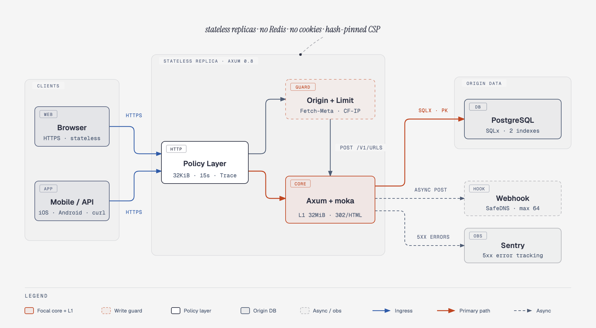

# URL 단축 서비스

[한국어](README.md) | [English](README.en.md)

🚀 **데모:** [https://u.lou2.kr](https://u.lou2.kr)


Rust(Axum 0.8 + PostgreSQL + `moka`)로 만든 **무상태(stateless) 고속 공개 URL 단축 서비스**입니다.
별도 Redis나 세션 토큰 없이 PostgreSQL 하나만으로 동작하며, 앱 딥링크·플랫폼 폴백·Open Graph 미리보기·클릭 웹훅을 지원하고 일반 링크는 `302` 한 번으로 즉시 리디렉션합니다.

## 주요 기능

- **충돌 없는 단축키**: DB `id` 기반(`접두사(2) + base62(id) + 접미사(2)`, 초기 2자리 레거시 키 호환) — I/O 전 제로할당 Base62 파싱, 같은 내용은 기존 링크 재사용
- **딥링크**: iOS / iPadOS / Android 딥링크 + 스토어 폴백, 앱이 열리면(`visibilitychange`/`pagehide`/`blur`) 폴백 타이머 자동 취소
- **소셜 미리보기**: Open Graph / Twitter Card 태그 자동 생성 + 폼 내 실시간 미리보기
- **클릭 웹훅**: 방문마다 비동기 `POST`, DNS 피닝 SSRF 방어, 동시성 제한(64), 종료 시 최대 5초 드레인
- **인프로세스 TinyLFU 캐시**: `id` 키 단일 `moka` L1(존재 60초·없음 15초, singleflight, 32 MiB 상한) — Redis 없이 수평 확장 시 각 인스턴스가 독립적으로 핫셋 유지
- **최신 웹 보안 기본 적용**: W3C Fetch Metadata(`Sec-Fetch-Site`/`Origin`) 무상태 CSRF 방어, `http(s)` 허용 목록, 스크립트 SHA-256 고정 CSP + `frame-ancestors 'none'`, `CF-Connecting-IP` GCRA 레이트 리밋

## 아키텍처

<picture>
  <source media="(prefers-color-scheme: dark)" srcset="docs/diagrams/architecture-dark.png">
  
</picture>

| 영역 | 기술 |
|------|------|
| 웹 | Axum 0.8, Tower, Tokio |
| 데이터 | PostgreSQL 15 + SQLx (마이그레이션 내장, 부팅 시 무중단 실행) |
| 캐시 | `moka` TinyLFU 인프로세스 L1 (바이트 상한 32 MiB, singleflight) |
| 보안 가드 | W3C Fetch Metadata(`Sec-Fetch-Site`/`Origin`) + `tower_governor` GCRA |
| 페이지 | `views/` 순수 HTML/CSS/JS (빌드 단계·외부 CDN 없음), 리디렉션은 Askama 렌더링 |
| 운영 | Sentry, `tracing`, mimalloc(Linux/macOS), graceful shutdown |

### 리디렉션: `GET /{short_key}`

<picture>
  <source media="(prefers-color-scheme: dark)" srcset="docs/diagrams/url-redirect-flow-dark.png">
  
</picture>

| 링크 구성 | 응답 |
|-----------|------|
| 목적지 URL만 있음 (웹훅 유무 무관) | `302 Found` + `Location`, 본문 없음 |
| 딥링크, 플랫폼 폴백 또는 Open Graph 필드가 있음 | `200 OK` HTML: OG 태그 + 플랫폼별 리디렉션 스크립트 |
| 잘못되었거나 없거나 삭제된 키 | `404` `{"error":"URL not found"}` |

모든 리디렉션 응답에는 `Cache-Control: private, no-cache`가 붙어 클릭마다 원본 서버에 도달합니다(웹훅 발송 및 삭제 반영).

<picture>
  <source media="(prefers-color-scheme: dark)" srcset="docs/diagrams/platform-redirect-dark.png">
  
</picture>

HTML 페이지 동작: 데스크톱은 즉시 목적지로 교체 이동합니다(`location.replace`). iOS·iPadOS(`MacIntel` + 터치 감지)·Android는 딥링크를 시도하고, 1.5초 뒤에도 페이지가 보이면 플랫폼 폴백(없으면 목적지)으로 교체 이동합니다. 앱이 열려 페이지가 숨겨지거나 포커스를 잃으면 타이머를 취소하며, **Continue** 링크와 `<noscript>` 폴백을 항상 제공합니다.

### 단축키

<picture>
  <source media="(prefers-color-scheme: dark)" srcset="docs/diagrams/short-key-encoding-dark.png">
  
</picture>

- 형식: 현행 `[랜덤 2자][base62(id)][랜덤 2자]`(길이 `5..=15`) 및 초기 레거시 `[랜덤 1자][base62(id)][랜덤 1자]`(길이 `3..=4`), 문자 집합 `0-9A-Za-z`, ID 부분은 `0`으로 시작 불가
- 캐시·DB 접근 전에 스택 버퍼로 즉시 파싱하며 형식이 틀리면 `404`
- 랜덤 키를 저장값과 대조해 순차 ID 추측·열거를 차단

### 생성: `POST /v1/urls`

<picture>
  <source media="(prefers-color-scheme: dark)" srcset="docs/diagrams/url-creation-flow-dark.png">
  
</picture>

브라우저 요청은 W3C Fetch Metadata(`Sec-Fetch-Site`/`Origin`)로 교차 출처 위조를 차단하고 IP별 GCRA 레이트 리밋을 적용합니다. 정규화·검증 후 9개 필드 전체의 length-prefixed SHA-256으로 중복을 판별합니다(`SELECT` → `INSERT … ON CONFLICT DO NOTHING` → 경합 시 재조회). 중복 요청은 시퀀스를 소모하지 않으며, 새 링크는 즉시 L1 캐시를 예열합니다.

### 캐싱 및 수평 확장

<picture>
  <source media="(prefers-color-scheme: dark)" srcset="docs/diagrams/caching-strategy-dark.png">
  
</picture>

인프로세스 `moka` TinyLFU 캐시가 디코딩된 `i64 id`를 키로 동작합니다(존재 60초, 없음 15초, 바이트+오버헤드 가중치 상한 32 MiB, 동시 콜드 미스 singleflight 병합). 별도 Redis L2 없이도 각 인스턴스가 핫셋을 독립적으로 유지하고 미스는 `urls_pkey` B-Tree(0.03 ms)로 처리하므로, 장애 지점(SPOF) 없이 깔끔하게 수평 확장됩니다.

## 시작하기

Rust(1.88+, `Cargo.toml`의 `rust-version` 참고)와 Docker가 필요합니다.

```bash
git clone https://github.com/lee-lou2/url-shortener.git && cd url-shortener
docker compose up -d      # 개발용 PostgreSQL 15
cp .env.example .env
cargo run                 # 마이그레이션 자동 적용 후 http://localhost:3000
```

검사: `cargo fmt --check && cargo clippy --locked --all-targets -- -D warnings && cargo test --locked` (통합 테스트는 compose PostgreSQL을 사용합니다).
운영은 Cloudflare Tunnel 뒤 컨테이너(`Dockerfile`, `deploy.sh`)로 `RUST_ENV=production`에서 실행합니다.

## 환경 변수

기준 목록은 [`.env.example`](.env.example)입니다.

| 변수 | 기본값 | 설명 |
|------|--------|------|
| `SERVER_PORT` | `3000` | HTTP 포트 |
| `RUST_ENV` | `development` | `production`/`prod` 또는 `development`/`dev`/`test` (대소문자 무관) |
| `RUST_LOG` | `info` | `tracing_subscriber` 로그 필터 |
| `DB_HOST`, `DB_PORT`, `DB_USER`, `DB_PASSWORD`, `DB_NAME` | `.env.example` 참고 | PostgreSQL 접속 정보 (`PgConnectOptions`로 특수문자 비밀번호 안전) |
| `DB_MAX_CONNECTIONS` | `10` | 커넥션 풀 크기 |
| `RUN_MIGRATIONS` | `true` | 부팅 시 `migrations/` 적용 (`true`/`1`/`yes`, `false`/`0`/`no`) |
| `CACHE_MAX_CAPACITY_BYTES` | `33554432` | 인프로세스 L1 바이트 상한 (32 MiB) |
| `RATE_LIMIT_PER_SECOND` | `10` | `POST /v1/urls`의 IP별 초당 허용량 |
| `RATE_LIMIT_BURST_SIZE` | `20` | `POST /v1/urls`의 IP별 버스트 |
| `CORS_ORIGINS` | — | 교차 출처 브라우저 `POST`를 허용할 오리진(쉼표 구분). 비어 있으면 동일 출처 브라우저 + 직접 API 클라이언트만 허용 (`*`는 개발 전용) |
| `SENTRY_DSN`, `SENTRY_TRACES_SAMPLE_RATE` | — / `0.1` | 선택 사항, 5xx 오류 보고 및 샘플링 비율(`0.0..=1.0`) |

이전 버전의 제거된 변수(`REDIS_*`, `JWT_*`, `CACHE_TTL_SECS` 등)는 안전하게 무시되며, 빈 값(`KEY=`)은 기본값으로 처리됩니다.

## API

| 메서드 | 경로 | 설명 |
|--------|------|------|
| `GET` | `/` | 다크 글래스모피즘 웹 UI (쿠키 없음, 무외부 CDN, SHA-256 CSP) |
| `POST` | `/v1/urls` | 공개 단축 링크 생성 또는 기존 링크 재사용 (토큰 불필요, Fetch Metadata + IP 제한) |
| `GET` | `/{short_key}` | `302` 또는 HTML 리디렉션 (`HEAD` 지원) |
| `GET` | `/health` | `{"status":"ok","version":"…"}` |
| `GET` | `/ready` | PostgreSQL `SELECT 1` 검사 (`200 ok` / `503 error`) |

### `POST /v1/urls`

별도 쿠키·토큰 없이 단일 요청으로 바로 생성합니다:

```bash
curl -s https://u.lou2.kr/v1/urls \
  -H 'Content-Type: application/json' \
  -d '{"defaultFallbackUrl":"https://example.com","iosDeepLink":"myapp://home","iosFallbackUrl":"https://apps.apple.com/app/myapp"}'
# => {"message":"URL shortened successfully","short_key":"Ab3D7Xy","created":true}
```

| 필드 | 필수 | 규칙 |
|------|:----:|------|
| `defaultFallbackUrl` | ✓ | `http`/`https` URL, 2048바이트 이하 |
| `iosFallbackUrl`, `androidFallbackUrl`, `ogImageUrl` | | `http`/`https` URL |
| `iosDeepLink`, `androidDeepLink` | | `javascript`, `data`, `vbscript`, `file`, `blob`, `about` 제외 모든 스킴 |
| `ogTitle` / `ogDescription` | | 200자 이하 / 500자 이하 |
| `webhookUrl` | | 공개 호스트 `http`/`https` URL, 방문마다 `POST {"short_key","user_agent"}` 수신 |

빈 문자열은 값 없음으로 처리합니다. 성공: `201` (`created: true`) 또는 `200` (`created: false`). 모든 오류는 `{"error":"…"}` 형식입니다: `400`/`422` 검증 실패, `403` 교차 출처 차단, `408` 타임아웃(15초), `413` 32 KiB 초과, `429` 레이트 리밋(`Retry-After` 포함), `500` 일반화 오류.

## 보안 모델

- **XSS & 클릭재킹:** URL 허용 목록(`http`/`https`, 딥링크 실행형 스킴 차단)을 생성 시점과 캐시 컴파일 시점에 모두 적용합니다. 두 뷰는 단일 bare `<script>`만 가지며 부팅 시 `script-src 'sha256-…'` + `frame-ancestors 'none'` CSP를 고정하고, 동적 데이터는 이스케이프된 `data-*` 속성으로만 전달하며 `X-Content-Type-Options: nosniff`를 보냅니다.
- **무상태 CSRF 방어:** 쿠키·게스트 토큰 대신 W3C Fetch Metadata(`Sec-Fetch-Site`) + `Origin`/`Host` 검증으로 타 사이트 브라우저의 위조 `POST /v1/urls`를 `403`으로 차단합니다.
- **SSRF 방어:** 웹훅은 공유 클라이언트의 `SafeDnsResolver`가 사설·루프백·링크로컬/메타데이터(`169.254.169.254`)·CGNAT·ULA·IPv4-mapped IPv6를 거부하고 검증된 IP에 직접 연결합니다(리디렉션 비활성, 5초 타임아웃, 동시성 64 제한, 종료 시 5초 드레인).
- **남용 제한:** `POST /v1/urls`에 IP별 GCRA 레이트 리밋(신뢰된 사설/루프백 피어에서만 `CF-Connecting-IP` 사용, 60초마다 유휴 키 정리). 리디렉션·헬스체크는 제한하지 않습니다.
- **삭제(테이크다운):** `UPDATE urls SET deleted_at = now() WHERE id = …` (L1 항목은 60초 이내 자동 만료).

## 성능

단일 CPU 워커(`TOKIO_WORKER_THREADS=1`), 로컬 macOS(Apple Silicon)의 PostgreSQL 15.19(**100만 행**, 일반 링크 ~85% + OG/딥링크 ~15%) 환경에서 초기 v1(리디자인 전 · Redis L2)과 현재(L1 전용 `moka` + PostgreSQL)를 동일 하네스로 실측한 결과입니다(운영 Linux 컨테이너 절대치와는 다를 수 있습니다).

| 항목 | v1 (리디자인 전) | 현재 (L1 + PG) | 변화 |
|------|------------------:|------------------:|------|
| PostgreSQL 인덱스 (100만 행) | 5개 (**129.8 MB**) | 2개 (**78.0 MB**) | **-39.9%** (중복 제거) |
| 10,000건 벌크 `INSERT` / WAL | 63.5k rows/s · 4.10 MB | **119.8k rows/s · 1.76 MB** | **1.89배 · WAL -57.1%** |
| 핫 Zipfian 리디렉션 (c=32, `br,gzip`) | 20,643 RPS (p99 2.27 ms) | **147,417 RPS** (p99 **0.31 ms**) | **7.14배 RPS · p99 7.3배 개선** |
| 콜드 랜덤 100만 건 (c=32, `br,gzip`) | 15,337 RPS (p99 3.17 ms) | **35,475 RPS** (p99 **1.32 ms**) | **2.31배 RPS · p99 2.4배 개선** |
| 오타 `random_key` 2,000건 (`id=42`) | PG 스캔 **2,000회** | PG 스캔 **1회** | **-99.95% DB 부하** |
| 선행 `'0'` 별칭 2,000건 공격 | `200` 2,000건 · 캐시 오염 | **`404` 2,000건 · DB 0회** | I/O 전 100% 차단 |
| 200-way 콜드 스탬피드 | PG 스캔 **20회** (p99 16.80 ms) | PG 스캔 **1회** (p99 **6.76 ms**) | singleflight로 20배 감소 |
| 중복 생성 50건 시퀀스 소모 / OG 하이재킹 | 시퀀스 50 소모 · 하이재킹 발생 | **시퀀스 0 소모 · 키 분리** | 9필드 SHA-256 + `SELECT` 우선 |

## 프로젝트 구조

```
├── src/          평면 모듈 11개 (main, lib, config, error, short_key, guard, links, redirect, cache, webhook, handlers)
├── views/        index.html(다크 글래스모피즘 UI), redirect.html(딥링크·OG Askama 템플릿)
├── migrations/   SQLx 마이그레이션 (적용된 파일은 수정 금지)
├── tests/        실제 PostgreSQL을 쓰는 라우터 통합 테스트
├── compose.yaml  개발용 PostgreSQL 15
└── docs/         스크린샷과 에디토리얼 다이어그램 (docs/diagrams/README.md)
```

기여자와 AI 코딩 에이전트는 [AGENTS.md](AGENTS.md)를 먼저 읽어 주세요.

## 라이선스

MIT License
