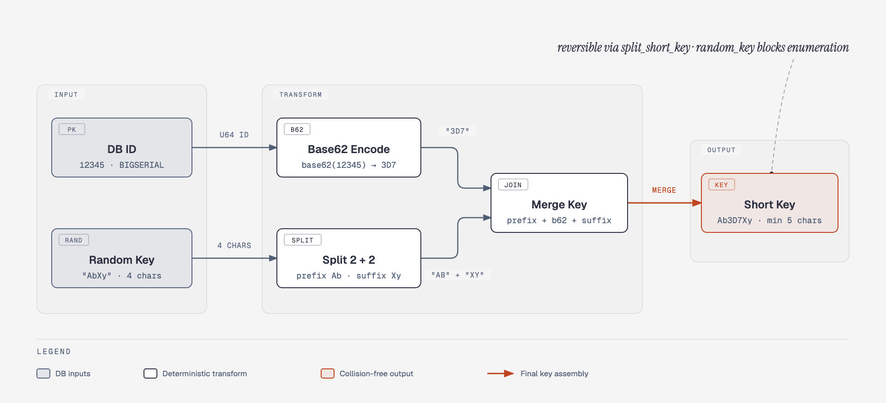
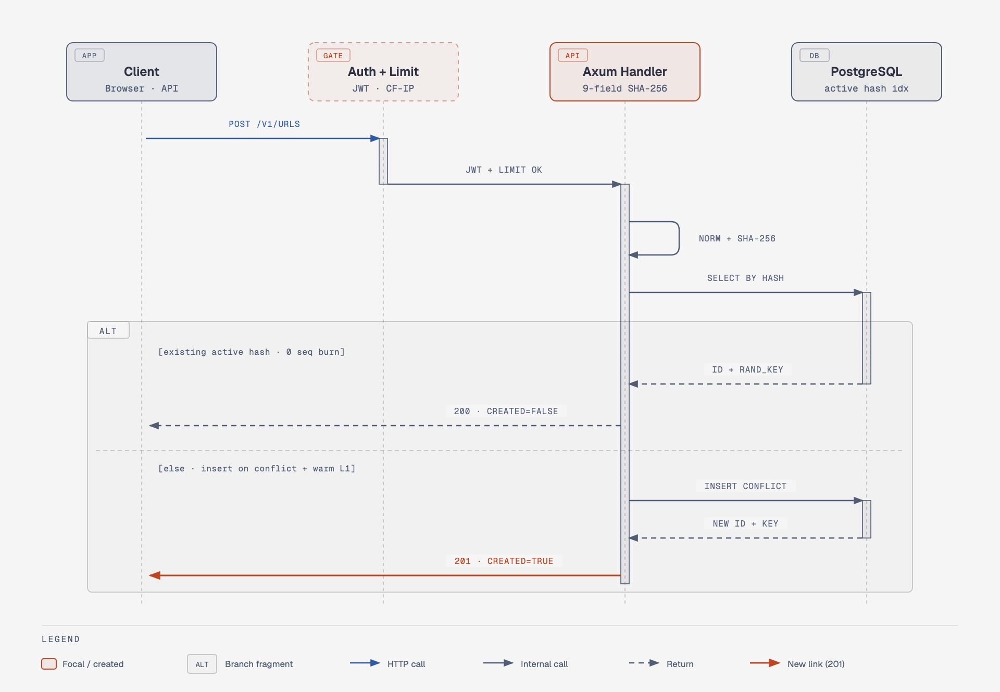

# URL 단축 서비스

[한국어](README.md) | [English](README.en.md)

🚀 **데모:** [https://u.lou2.kr](https://u.lou2.kr)


Rust(Axum + PostgreSQL)로 만든 빠른 URL 단축 서비스입니다. 앱 딥링크, 플랫폼별 폴백, Open Graph 미리보기, 클릭 웹훅을 지원하며
일반 링크는 `302` 한 번으로 리디렉션합니다.

## 주요 기능

- **충돌 없는 단축키**: DB id 기반 (`접두사(2) + base62(id) + 접미사(2)`), 같은 내용으로 다시 만들면 기존 링크를 반환
- **딥링크**: iOS / iPadOS / Android 딥링크 + 스토어 폴백, 앱이 열리면 폴백 타이머를 취소
- **소셜 미리보기**: 링크 미리보기 크롤러용 Open Graph / Twitter Card 태그, 생성 폼에서 실시간 미리보기
- **클릭 웹훅**: 방문마다 비동기 `POST`, SSRF 방어, 동시성 제한, 종료 시 진행 중 호출 드레인
- **계층형 캐시**: 프로세스 내 `moka` L1, 선택적 Redis L2(JSON), 원본은 PostgreSQL
- **기본 보안**: `http(s)` 허용 목록, 해시 고정 CSP, IP별 레이트 리밋, 일반화된 5xx 오류, 시작 시 설정 검증

## 아키텍처

<!-- docs/diagrams PNG는 v2 리디자인이 합쳐진 뒤 다시 생성합니다 -->
<picture>
  <source media="(prefers-color-scheme: dark)" srcset="docs/diagrams/architecture-dark.png">
  
</picture>

| 영역 | 기술 |
|------|------|
| 웹 | Axum 0.8, Tower, Tokio |
| 데이터 | PostgreSQL + SQLx (마이그레이션 내장, 부팅 시 실행) |
| 캐시 | `moka`(L1) + 선택적 Redis `ConnectionManager`(L2, `u:{id}` JSON) |
| 페이지 | `views/`의 순수 HTML/CSS/JS (빌드 단계·CDN 없음), 리디렉션 페이지는 Askama로 렌더링 |
| 인증 | 게스트 JWT (`token` 쿠키 또는 `Authorization: Bearer`) |
| 운영 | Sentry, `tracing`, graceful shutdown |

### 리디렉션: `GET /{short_key}`

<picture>
  <source media="(prefers-color-scheme: dark)" srcset="docs/diagrams/url-redirect-flow-dark.png">
  
</picture>

| 링크 구성 | 응답 |
|-----------|------|
| 목적지 URL만 있음 (웹훅은 무관) | `302 Found` + `Location`, 본문 없음 |
| 딥링크, 플랫폼 폴백 또는 Open Graph 필드가 있음 | `200 OK` HTML: OG 태그 + 플랫폼별 리디렉션 스크립트 |
| 잘못되었거나 없거나 삭제된 키 | `404` `{"error":"URL not found"}` |

모든 리디렉션 응답에는 `Cache-Control: private, no-cache`가 붙어 클릭마다 원본 서버에 도달합니다(웹훅 발송, 삭제 즉시 반영).

<picture>
  <source media="(prefers-color-scheme: dark)" srcset="docs/diagrams/platform-redirect-dark.png">
  
</picture>

HTML 페이지의 동작: 데스크톱 브라우저는 목적지로 바로 이동합니다. iOS, iPadOS(`MacIntel` + 터치로 감지), Android에서는 딥링크를 시도하고,
1.5초 뒤에도 페이지가 보이는 상태면 플랫폼 폴백(없으면 목적지)으로 교체 이동합니다. 페이지가 숨겨지거나 포커스를 잃으면(앱이 열림) 타이머를 취소합니다.
이동에는 `location.replace`를 써서 뒤로 가기 루프가 생기지 않으며, **계속하기** 링크가 항상 보이고 JavaScript가 꺼져 있으면 `<noscript>` 안의 즉시 `<meta refresh>`로 목적지로 이동합니다.

### 단축키

<picture>
  <source media="(prefers-color-scheme: dark)" srcset="docs/diagrams/short-key-encoding-dark.png">
  
</picture>

- 형식 `[랜덤 2자][base62(id)][랜덤 2자]`, 문자 집합 `0-9A-Za-z`, 길이 `5..=15`, id 부분은 `0`으로 시작하지 않음
- 캐시·DB 접근 전에 키를 먼저 파싱하며, 형식이 틀리면 `404`
- 랜덤 부분은 저장된 `random_key`와 대조해 id 추측으로 순차 열거하기 어렵게 만듦

### 생성: `POST /v1/urls`

<picture>
  <source media="(prefers-color-scheme: dark)" srcset="docs/diagrams/url-creation-flow-dark.png">
  
</picture>

필드를 공백 제거(빈 값은 없음으로 처리) 후 한 번만 검증하고, 정규화된 9개 필드 전체의 SHA-256으로 링크를 식별합니다:
`SELECT` → `INSERT … ON CONFLICT DO NOTHING` → 동시 경합일 때만 다시 `SELECT`. 중복 요청은 시퀀스를 소모하지 않고, 새 링크는 L1 캐시를 미리 채웁니다.

### 캐싱

<picture>
  <source media="(prefers-color-scheme: dark)" srcset="docs/diagrams/caching-strategy-dark.png">
  
</picture>

L1은 디코딩한 id를 키로 쓰며(존재하는 항목 60초, 없는 항목 15초, 바이트 상한, 같은 키의 동시 로드는 하나로 합침) L2 Redis는 선택 사항입니다.
`REDIS_HOST`가 없거나 Redis가 내려가도 L1 + PostgreSQL로 계속 서비스합니다.

## 시작하기

Rust(1.88+, `Cargo.toml`의 `rust-version` 참고)와 Docker가 필요합니다.

```bash
git clone https://github.com/lee-lou2/url-shortener.git && cd url-shortener
docker compose up -d      # 개발용 PostgreSQL 15 + Redis 7
cp .env.example .env
cargo run                 # 마이그레이션 적용 후 http://localhost:3000
```

검사: `cargo fmt --check && cargo clippy --all-targets -- -D warnings && cargo test` (테스트는 compose 서비스를 사용합니다).
운영은 Cloudflare Tunnel 뒤의 단일 컨테이너로 `RUST_ENV=production`에서 실행합니다(`Dockerfile`, `deploy.sh` 참고).

## 환경 변수

주석이 달린 기준 목록은 [`.env.example`](.env.example)입니다.

<!-- src/config.rs, .env.example 과 항상 일치시킬 것 -->

| 변수 | 기본값 | 설명 |
|------|--------|------|
| `SERVER_PORT` | `3000` | HTTP 포트 |
| `RUST_ENV` | `development` | `production`이면 `JWT_SECRET`(32바이트 이상) 필수, 쿠키에 `Secure` 추가 |
| `RUST_LOG` | `info` | `tracing_subscriber` 로그 필터 |
| `JWT_SECRET` | — | 게스트 토큰 서명 시크릿 |
| `JWT_EXPIRATION_HOURS` | `24` | `1..=8760`, 쿠키 `Max-Age`로도 사용 |
| `DB_HOST`, `DB_PORT`, `DB_USER`, `DB_PASSWORD`, `DB_NAME` | `.env.example` 참고 | PostgreSQL 접속 정보 (특수문자 비밀번호도 안전) |
| `DB_MAX_CONNECTIONS` | `10` | 커넥션 풀 크기 |
| `RUN_MIGRATIONS` | `true` | 부팅 시 `migrations/` 적용 |
| `REDIS_HOST` | — | 비어 있으면 L1 전용 모드 (`/ready`의 `cache: "disabled"`) |
| `REDIS_PORT`, `REDIS_USER`, `REDIS_PASSWORD`, `REDIS_DB` | `.env.example` 참고 | Redis 접속 정보 (L2 TTL은 L1과 동일한 최대 60초) |
| `CACHE_MAX_CAPACITY_BYTES` | `33554432` | L1 바이트 상한 (32 MiB) |
| `RATE_LIMIT_PER_SECOND` | `10` | `POST /v1/urls`, `GET /`의 IP별 초당 허용량 |
| `RATE_LIMIT_BURST_SIZE` | `20` | 같은 경로의 IP별 버스트 |
| `CORS_ORIGINS` | — | 쉼표로 구분한 오리진, 비어 있으면 CORS 비활성(동일 출처 전용) |
| `SENTRY_DSN`, `SENTRY_TRACES_SAMPLE_RATE` | — / `0.1` | 선택 사항, 5xx 오류 보고 및 트레이스 샘플링 비율(`0.0..=1.0`) |

## API

| 메서드 | 경로 | 인증 | 설명 |
|--------|------|:----:|------|
| `GET` | `/` | – | 웹 UI, 게스트 쿠키 `token` 발급 (`HttpOnly; SameSite=Lax; Path=/; Max-Age=…`, 운영에서는 `Secure`) |
| `POST` | `/v1/urls` | 토큰 | 단축 링크 생성 또는 재사용 |
| `GET` | `/{short_key}` | – | `302` 또는 HTML 리디렉션 (위 표 참고) |
| `GET` | `/health` | – | `{"status":"ok","version":"…"}` |
| `GET` | `/ready` | – | PostgreSQL `SELECT 1` + Redis `PING`: `200 ok`, `200 degraded`(Redis 장애, 서비스는 계속), `503 error`(DB 장애) |

### `POST /v1/urls`

`token` 쿠키 또는 `Authorization: Bearer <token>`(스킴은 대소문자 무관)이 필요합니다. 토큰은 사용자 신원이 아닌 게스트 토큰입니다:

```bash
# 1) 게스트 쿠키 받기
curl -s -c jar.txt https://u.lou2.kr/ -o /dev/null
# 2) 링크 생성
curl -s -b jar.txt https://u.lou2.kr/v1/urls \
  -H 'Content-Type: application/json' \
  -d '{"defaultFallbackUrl":"https://example.com","iosDeepLink":"myapp://home","iosFallbackUrl":"https://apps.apple.com/app/myapp"}'
# => {"message":"URL shortened successfully","short_key":"Ab3D7Xy","created":true}
```

| 필드 | 필수 | 규칙 |
|------|:----:|------|
| `defaultFallbackUrl` | ✓ | `http`/`https` URL, 2048바이트 이하 |
| `iosFallbackUrl`, `androidFallbackUrl`, `ogImageUrl` | | `http`/`https` URL |
| `iosDeepLink`, `androidDeepLink` | | `javascript`, `data`, `vbscript`, `file`, `blob`, `about`을 제외한 모든 스킴 |
| `ogTitle` / `ogDescription` | | 200자 이하 / 500자 이하 |
| `webhookUrl` | | 공개 호스트의 `http`/`https` URL, 방문마다 `POST {"short_key","user_agent"}` 수신 |

빈 문자열은 값이 없는 것으로 처리합니다. 성공: `201` `{"message":"URL shortened successfully","short_key":"…","created":true}`, 또는 `200`
`{"message":"URL already exists","short_key":"…","created":false}`. 모든 오류는 `{"error":"…"}` 형식입니다: `400`/`422` 검증 실패, `401` 토큰 없음·무효,
`408` 타임아웃(15초), `413` 본문 32 KiB 초과, `429` 레이트 리밋(`Retry-After` 포함), `500` 일반화된 서버 오류.

## 보안 모델

- **XSS:** URL은 허용 목록(`http`/`https`, 딥링크는 실행형 스킴 제외)으로 검증하고, 캐시 항목을 만들 때 다시 검증하므로 과거 데이터의 `javascript:`도 통하지 않습니다.
  두 페이지 모두 인라인 스크립트가 정확히 하나이며 `script-src 'sha256-…'`(`default-src 'none'`)로 고정되고, 동적 데이터는 이스케이프된 `data-*` 속성으로만 전달하며 `X-Content-Type-Options: nosniff`를 보냅니다.
- **SSRF:** 웹훅은 공용이 아닌 주소(루프백, RFC 1918, 링크로컬/메타데이터, CGNAT, ULA, 매핑된 IPv4)를 거부하는 DNS 리졸버를 가진 공유 클라이언트를 사용하고,
  리터럴 IP 호스트는 생성·발송 시점에 모두 검사하며, 리디렉션 비활성화, 5초 타임아웃, 동시성 제한, 종료 시 드레인을 적용합니다.
- **남용 제한:** `POST /v1/urls`와 `GET /`에 IP별 레이트 리밋. Cloudflare 뒤에서는 `CF-Connecting-IP`를 쓰되 TCP 피어가 루프백/사설 주소일 때만 신뢰합니다. 리디렉션과 헬스체크는 제한하지 않습니다.
- **인증:** 게스트 JWT는 신원이 아니라 속도 제한용 장치입니다(`/`만 열면 누구나 받음). 운영에서는 32바이트 이상의 `JWT_SECRET` 없이는 시작하지 않습니다.
- **기본 위생:** JSON 오류와 일반화된 5xx 메시지, 32 KiB 본문 제한, 15초 요청 타임아웃, 접속 URL에 자격 증명을 끼워 넣지 않음.
- **삭제(테이크다운):** `UPDATE urls SET deleted_at = now() WHERE id = …` (L1 항목은 60초 안에 만료, Redis L2를 켰다면 `DEL u:{id}`도 실행).

## 성능

<!-- BENCHMARK_TABLE -->
벤치마크 스위트의 실측 결과를 이곳에 게시합니다. 그 전까지는 어떤 성능 수치도 주장하지 않습니다.
<!-- /BENCHMARK_TABLE -->

## 프로젝트 구조

```
├── src/          평면 모듈 11개 (main, lib, config, error, short_key, auth, links, redirect, cache, webhook, handlers)
├── views/        index.html(생성 UI), redirect.html(딥링크·OG 리디렉션용 Askama 템플릿)
├── migrations/   SQLx 마이그레이션 (적용된 파일은 수정 금지)
├── tests/        실제 PostgreSQL·Redis를 쓰는 라우터 테스트
├── compose.yaml  개발용 PostgreSQL 15 + Redis 7
└── docs/         스크린샷과 에디토리얼 다이어그램 (docs/diagrams/README.md)
```

기여자와 AI 코딩 에이전트는 [AGENTS.md](AGENTS.md)를 먼저 읽어 주세요.

## 라이선스

MIT License
