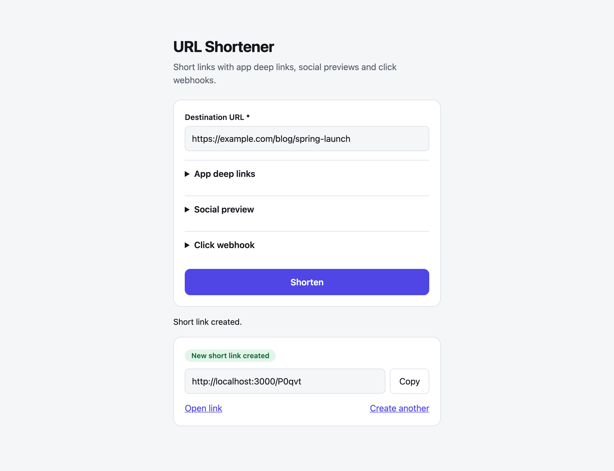
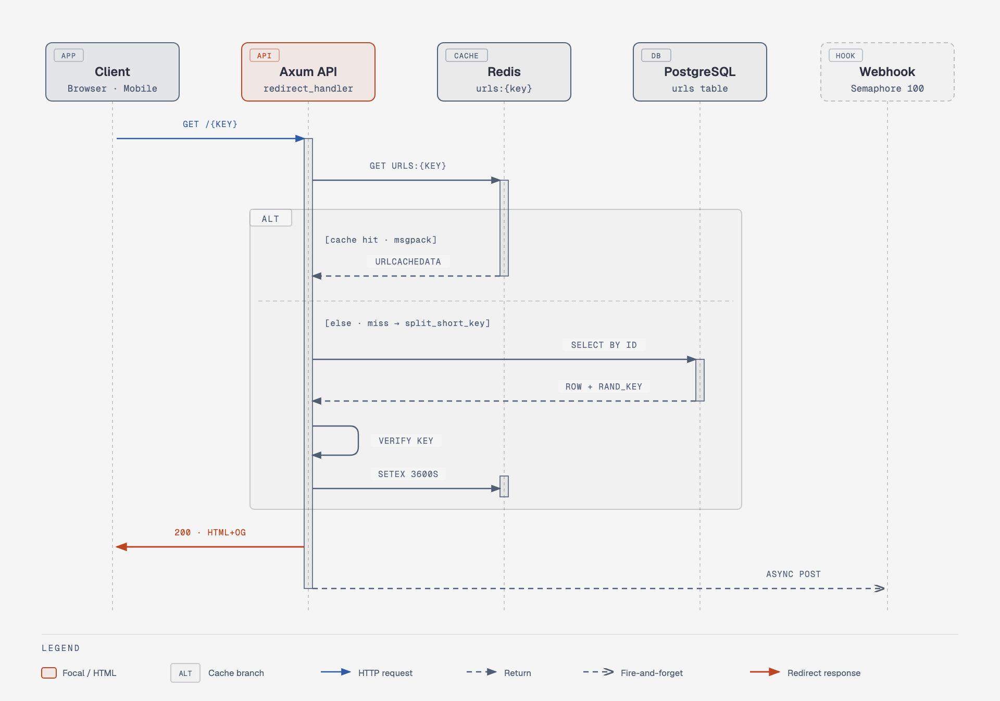
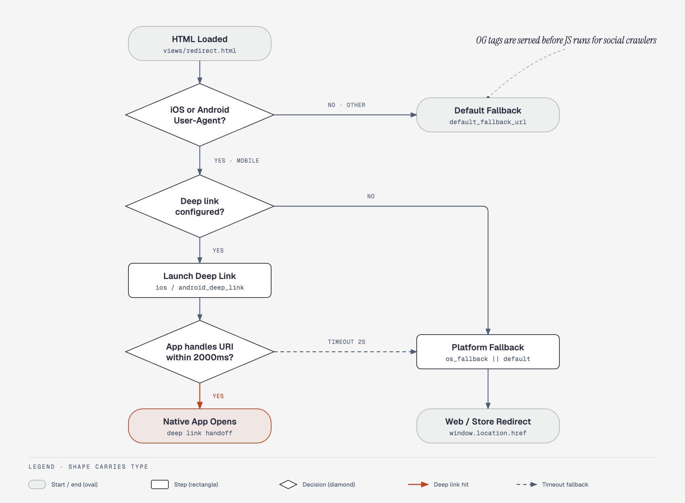
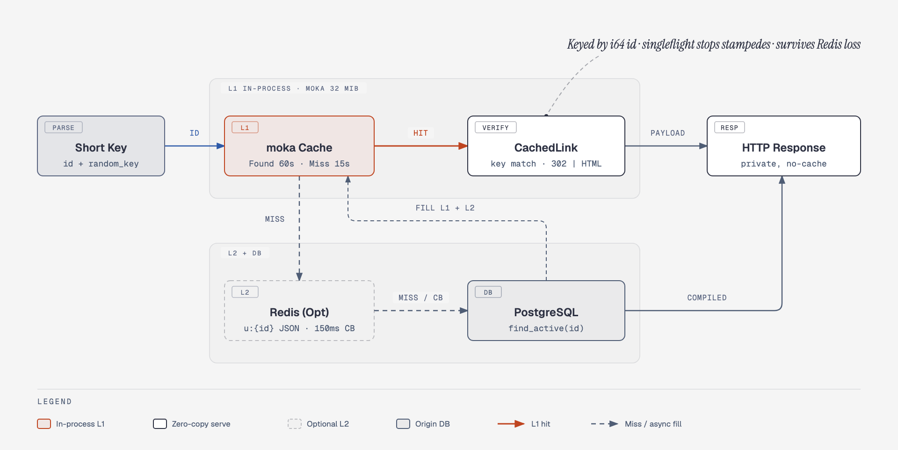

# URL 단축 서비스

[한국어](README.md) | [English](README.en.md)

🚀 **데모:** [https://u.lou2.kr](https://u.lou2.kr)



Rust로 개발된 고성능 URL 단축 서비스입니다. 딥 링크 처리, 플랫폼별 리디렉션, OG 메타 태그, JWT 인증, Redis MessagePack 캐싱, 웹훅 알림을 지원합니다.

## 아키텍처

<picture>
  <source media="(prefers-color-scheme: dark)" srcset="docs/diagrams/architecture-dark.png">
  
</picture>

## 핵심 기술

| 영역 | 기술 | 설명 |
|------|------|------|
| 웹 프레임워크 | **Axum 0.8 + Tower** | 비동기 HTTP 서버, SmartIP 레이트 리미팅, gzip/br/zstd 압축 |
| 데이터베이스 | **PostgreSQL + SQLx** | 타입 안전 쿼리, 자동 마이그레이션 |
| 캐시 | **Redis + MessagePack** | `rmp-serde` 바이너리 직렬화 캐싱 (`urls:{short_key}`) |
| 인증 | **JWT** | `Authorization: Bearer` 헤더 및 `token` 쿠키 인증 |
| 해싱 | **xxHash (`xxh3_128`)** | 중복 URL 고속 감지 (`ON CONFLICT` 레이스 방지) |
| 템플릿 | **Askama** | 컴파일 타임 검증 HTML 렌더링 (OG 태그 + 딥링크 스크립트) |
| 메모리 | **mimalloc** | 고성능 글로벌 메모리 할당자 |
| 모니터링 | **Sentry + tracing** | 구조화 로깅 및 5xx 서버 오류 자동 수집 |

## URL 생성 플로우

<picture>
  <source media="(prefers-color-scheme: dark)" srcset="docs/diagrams/url-creation-flow-dark.png">
  
</picture>

### 단축키 생성 방식

<picture>
  <source media="(prefers-color-scheme: dark)" srcset="docs/diagrams/short-key-encoding-dark.png">
  
</picture>

**특징:**
- DB `BIGSERIAL` ID 기반으로 충돌 없음
- 4자리 랜덤키를 접두사 2자 + 접미사 2자로 감싸 순차 추측(enumeration) 방지
- `split_short_key`로 역산 후 DB의 `random_key`와 일치 여부를 검증해 위변조 차단
- DB 크기와 무관하게 일정한 생성 성능

## URL 리디렉션 플로우

<picture>
  <source media="(prefers-color-scheme: dark)" srcset="docs/diagrams/url-redirect-flow-dark.png">
  
</picture>

### 플랫폼별 리디렉션

<picture>
  <source media="(prefers-color-scheme: dark)" srcset="docs/diagrams/platform-redirect-dark.png">
  
</picture>

- OG / Twitter Card / Schema.org 메타 태그가 HTML에 먼저 렌더링되어 SNS 크롤러가 미리보기를 정상 수집합니다.
- 모바일 브라우저에서 딥링크가 설정된 경우 앱 실행을 시도하고, 2초(`2000ms`) 내 전환되지 않으면 플랫폼 폴백 URL(미설정 시 `default_fallback_url`)로 이동합니다.

## 캐싱 전략

<picture>
  <source media="(prefers-color-scheme: dark)" srcset="docs/diagrams/caching-strategy-dark.png">
  
</picture>

**MessagePack 사용 이유:**
- JSON 대비 30–50% 작은 페이로드 크기 (`UrlCacheData`는 타임스탬프 필드 제외)
- 빠른 직렬화/역직렬화 (`rmp-serde`)
- 캐시 쓰기 실패 시에도 리디렉션 응답을 차단하지 않고 정상 처리

## 시작하기

### 사전 준비

- Rust (stable, `rust-toolchain.toml` 기준)
- PostgreSQL
- Redis

### 실행

```bash
# 저장소 복제
git clone https://github.com/lee-lou2/url-shortener.git
cd url-shortener

# 환경 변수 설정
cp .env.example .env

# 실행
cargo run --release
```

### Docker

```bash
docker build -t url-shortener .
docker run -p 3000:3000 --env-file .env url-shortener
```

### 주요 환경 변수

| 변수 | 기본값 | 설명 |
|------|--------|------|
| `SERVER_PORT` | `3000` | 서버 포트 |
| `RUST_ENV` | `development` | 실행 환경 (`production` 시 `JWT_SECRET`·Secure 쿠키 강제) |
| `DB_HOST` | `localhost` | PostgreSQL 호스트 |
| `REDIS_HOST` | `localhost` | Redis 호스트 |
| `REDIS_MAX_CONNECTIONS` | `20` | Redis 커넥션 풀 최대 크기 |
| `JWT_SECRET` | - | JWT 시크릿 (프로덕션 필수, 최소 32자) |
| `CACHE_TTL_SECS` | `3600` | Redis 캐시 TTL (초) |
| `RATE_LIMIT_PER_SECOND` | `10` | 초당 요청 제한 |
| `RATE_LIMIT_BURST_SIZE` | `50` | 레이트 리밋 버스트 허용량 |
| `WEBHOOK_TIMEOUT_SECS` | `10` | 웹훅 HTTP 타임아웃 (초) |
| `WEBHOOK_MAX_CONCURRENT` | `100` | 세마포어 기반 최대 동시 웹훅 수 |
| `RUN_MIGRATIONS` | `true` | 서버 시작 시 SQLx 마이그레이션 자동 실행 |

## API

| 메서드 | 경로 | 인증 | 설명 |
|--------|------|:----:|------|
| `GET` | `/` | - | 메인 페이지 렌더링 및 게스트 JWT 쿠키(`token`) 발급 |
| `POST` | `/v1/urls` | JWT | 단축 URL 생성 (중복 시 기존 `short_key` 반환) |
| `GET` | `/{short_key}` | - | OG 태그 및 플랫폼별 딥링크 리디렉션 HTML 반환 |
| `GET` | `/health` | - | Liveness 프로브 (`{ status, version }`) |
| `GET` | `/ready` | - | Readiness 프로브 (PostgreSQL·Redis 연결 확인) |

### `POST /v1/urls` - URL 생성

`Authorization: Bearer <token>` 헤더 또는 `token` 쿠키가 필요합니다.

**요청:**
```json
{
  "defaultFallbackUrl": "https://example.com",
  "iosDeepLink": "myapp://path",
  "iosFallbackUrl": "https://apps.apple.com/app/myapp",
  "androidDeepLink": "myapp://path",
  "androidFallbackUrl": "https://play.google.com/store/apps/details?id=com.myapp",
  "webhookUrl": "https://webhook.example.com",
  "ogTitle": "제목",
  "ogDescription": "설명",
  "ogImageUrl": "https://example.com/image.jpg"
}
```

**응답:**
```json
{
  "message": "URL created successfully",
  "short_key": "Ab3D7Xy"
}
```

### `GET /{short_key}` - 리디렉션

단축 URL을 원본 URL로 리디렉션하는 HTML 페이지를 반환하고, `webhookUrl`이 설정된 경우 `{ short_key, user_agent }` 페이로드를 비동기로 전송합니다.

## 프로젝트 구조

```
├── src/
│   ├── main.rs           # 진입점, 미들웨어 스택, graceful shutdown
│   ├── lib.rs            # 라이브러리 크레이트
│   ├── error.rs          # 중앙 에러 처리 (AppError, AppResult)
│   ├── api/              # HTTP 핸들러, 라우트, 스키마, JWT 미들웨어
│   ├── config/           # 환경 설정, PostgreSQL/Redis 풀 초기화
│   ├── models/           # Url, UrlCacheData, UrlRepository, 웹훅 전송
│   └── utils/            # JWT, Base62 단축키, 랜덤 문자열
├── migrations/           # SQLx 마이그레이션 SQL
├── views/                # Askama HTML 템플릿 (index.html, redirect.html)
├── tests/                # 통합 테스트 (DB 없이 실행 가능)
└── docs/
    ├── screenshot.png    # 데모 화면 캡처
    └── diagrams/         # 에디토리얼 아키텍처·플로우 다이어그램 (PNG + HTML/SVG 원본)
```

다이어그램 원본 목록은 [docs/diagrams/README.md](docs/diagrams/README.md)에서 확인할 수 있습니다.

## 라이선스

MIT License
